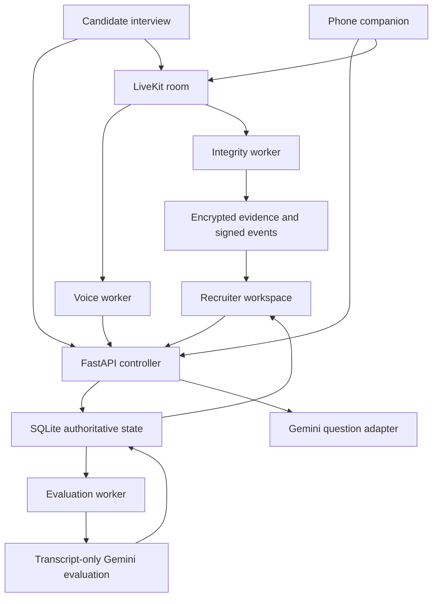

# Architecture and source map

## File responsibilities

| Path | Responsibility |
|---|---|
| backend/app/core.py | Deterministic primary slots, timer, commands, temporal rules, quote validation |
| backend/app/main.py | Request schemas, role checks, endpoints, atomic pairing, queueing |
| backend/app/store.py | SQLite WAL, transactions, persisted session state and credentials |
| backend/app/providers.py | Gemini schemas, bounded requests, question/score/follow-up contracts |
| backend/app/media.py | Server-issued LiveKit identities and least-privilege grants |
| backend/app/evidence.py | Fernet storage, verified checksum, HMAC manifest chain |
| workers/voice.py | Primary mic STT, explicit turn commands, interviewer TTS |
| workers/integrity.py | Two independent video readers, baseline CV, multi-frame evidence |
| workers/evaluation.py | Durable queued transcript evaluation and abstention |
| workers/common.py | Worker API client and media connection |
| web/app/page.tsx | Recruiter overview/configuration/report |
| web/app/interview/page.tsx | Consent, question/answer interaction, phone pairing QR |
| web/app/phone/page.tsx | Separate mobile consent and video-only camera |
| web/components/MediaRoom.tsx | LiveKit lifecycle, publication and remote playback |
| web/app/globals.css | Responsive product visual design and print rules |
| scripts/ | Setup, cross-platform runners, diagnostics and evidence verification |
| benchmarks/ | Metrics for real collected data |
| backend/tests/ | Pure behavior, API isolation, pairing and evidence tests |
| docs/openapi.json | Generated API request/response contract |

## Persistence model

The baseline stores session aggregate JSON to make state transitions atomic with minimal infrastructure. Each includes config, frozen questions/rubric, current slot, phase, timestamps, finalized spans, consents, event metadata, audit entries, coverage and idempotency records. Credentials and challenges are separate hashed lookup tables. Jobs are durable rows with queued/running/done state.

This deliberately serializes all writes via SQLite `BEGIN IMMEDIATE`. It is appropriate for a small single-host demo, not an untested scale claim. Move to normalized Postgres tables and leases when concurrent session demands warrant it; preserve tested contracts during migration.

## Trust boundaries

The browser may provide answers and requests but cannot create trusted integrity events. LiveKit identities are issued server-side. Integrity subscribers map exact participant identity to primary/secondary role, not arbitrary client labels. Media remains vulnerable to physically staged scenes or virtual cameras; this is not a liveness or identity verification product.

The scoring worker receives only question/follow-up, frozen rubric and transcript spans. Integrity data is isolated from assessment. Model JSON is untrusted until schema, ranges and exact evidence references pass validation. The recruiter can revise scores or event interpretations through append-only history.
